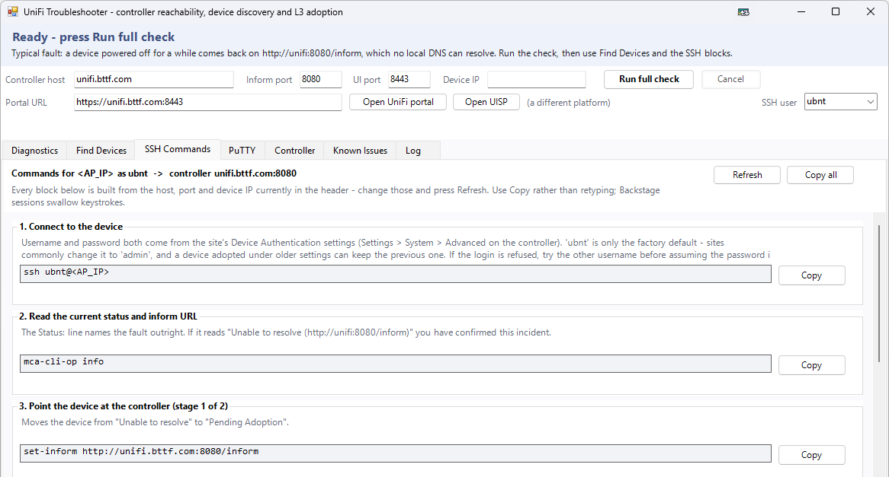

# UniFi Troubleshooter

An all-in-one **Windows PowerShell 5.1** WinForms tool for UniFi devices that have lost adoption or cannot reach a remote (Layer 3) controller. Built to be dropped onto a workstation at the affected site, including over a ScreenConnect Backstage session.

From [ihavenoram.com](https://ihavenoram.com): field notes for ADHD techs running managed services.



```
Launch-UniFiTool.cmd            <- run this
UniFi-Troubleshooter-Gui.ps1    <- the tool, one self-contained file
Test-UniFiTroubleshooter.ps1    <- older linear console script, kept as a fallback
```

## Download

Grab **`unifi.zip`** from **[Releases](../../releases/latest)**. It holds one folder, `unifi\`, with only what runs: the scripts and a `.cmd` launcher for each. Copy that folder to the PC or server (for example `C:\temp\unifi`); this README and the docs stay here on GitHub. The SHA-256 checksum is in the release notes and in the `.sha256` file beside the zip:

```powershell
Get-FileHash .\unifi.zip -Algorithm SHA256
```

## Run it

Use the launcher, not a double-click on the `.ps1`. WinForms needs `-STA` and the launcher supplies it. Point it at your controller:

```bat
Launch-UniFiTool.cmd -ControllerHost unifi.yourcompany.com
```

or directly:

```powershell
powershell.exe -NoProfile -STA -ExecutionPolicy Bypass -File ".\UniFi-Troubleshooter-Gui.ps1" -ControllerHost unifi.yourcompany.com
```

Add `-NoHideConsole` if you want to watch for errors. The window opens maximised, because there is a lot of table in here and a Backstage session is usually a small screen. Restore it down and it returns to a centred 1180x830.

Every setting is editable in the header once the tool is open. The defaults are placeholders:

| Setting | Parameter | Default |
| :--- | :--- | :--- |
| Controller host | `-ControllerHost` | `unifi.example.com` |
| Inform port | `-InformPort` | `8080` |
| UI port | `-UiPort` | `8443` |
| Portal URL | `-PortalUrl` | `https://unifi.example.com:8443` |
| UISP URL | `-UispUrl` | `https://example.uisp.com/nms/sites` |
| SSH user | (header dropdown) | `ubnt` (also offers `admin`; type anything) |

### The SSH username is a credential too

`ubnt` is only the *factory default*. Sites commonly change it to `admin` under **Settings → System → Advanced → Device Authentication**, and a device adopted under earlier settings can keep the previous one. A device will refuse `ubnt` outright when the site has been changed, which looks exactly like a wrong password.

The **SSH user** dropdown feeds the generated command blocks, the plink actions and the PuTTY launch, so changing it updates everything at once. It appears twice (top right of the header, and beside the launch button on the **PuTTY** tab), but they are two views of one value. The launch button reads *Launch PuTTY as &lt;user&gt;*, so the account is visible before you click.

Better still, connecting on the **Controller** tab reads `x_ssh_username` from the site and fills the field in for you. It also reports whether SSH is enabled for the site at all, which is another refused login that has nothing to do with credentials.

A factory-reset device is always `ubnt`/`ubnt`.

---

## The fault this was built for

A U6+ access point was powered off for about 40 minutes. It came back offline and unadopted, with its inform URL reset to the factory default `http://unifi:8080/inform`. That bare hostname did not resolve at the site, which ran on ISP DNS with no local resolver, so the device had no way to find the controller.

The network itself was never the problem. TCP 8080 was open and `/inform` returned **HTTP 400**, which is the *healthy* response, not a failure. The inform endpoint expects an encrypted payload from the device agent; a plain GET carries none, so a working controller rejects it. A firewall or a dead service gives a timeout instead. The tool reports HTTP 400 as a PASS and says why, because it reads like a failure to anyone seeing it for the first time.

### Why `set-inform` alone is usually not the fix

A device that reverts to `http://unifi:8080/inform` after a power cycle has two very different causes:

1. **The controller is telling it to.** With *Settings → System → Advanced → Override Inform Host* unset, the controller pushes its own detected hostname, often literally `unifi`, to every device each time it provisions them. `set-inform` then works only until the next provision. **This is the most likely cause, and the Controller tab reads it directly** from `super_mgmt.override_inform_host`.
2. **The device cannot persist its config.** Worn eMMC/flash leaves the partition read-only, so a change survives a warm `reboot` but is lost on a cold power-off, which matches a 40-minute outage exactly. That is a hardware fault and an RMA. SSH block 7 confirms it.

The tool separates these two rather than just re-issuing `set-inform`.

---

## Tabs

**Diagnostics:** adapters, DNS servers, resolution of both `unifi` and the controller FQDN, a best-effort read of any DHCP Option 43 this PC received, a port matrix that states the *consequence* of each port being shut, a STUN probe on UDP 3478, the inform probe, and the controller's own `/status` (which proves the application is alive, not just that the port is open).

**Find Devices:** click a device and it becomes the header **Device IP**; the SSH command blocks and both PuTTY buttons follow it. Double-click jumps straight to the commands for that device. Three discovery methods run together: the ARP cache filtered by Ubiquiti OUIs, an optional ping sweep of the local /24, and a **UDP 10001 Ubiquiti discovery broadcast**. The last is the one that finds a device after a long outage: it sees unadopted units and units holding a lease from another subnet, and reports model, firmware, uptime and whether the device is still on factory defaults. Windows Firewall can suppress the replies; the other two methods still stand if so.

### What discovery can and cannot tell you

The UDP 10001 reply carries IP, MAC, model, firmware, hostname, uptime and the factory-defaults flag, and nothing else. **Serial number, board revision and manufacturing week are not in it.** Any other field a particular firmware happens to send is dumped raw into *Other fields* as `0xNN=value` rather than being dropped.

Two ways to get the rest:

* **Serial** is filled in for every device the moment it is found, because UniFi hardware uses the MAC as its serial. The column is headed *Serial (from MAC)* so it is clear it was derived rather than read.
* **Read hardware info (SSH)** reads `/proc/ubnthal/system.info` from the selected device and fills in *Board rev* and *Mfg week / age*, replaces the derived serial with the device's own `serialno`, and puts everything else the file carries into *Other fields*. It needs the device password from the PuTTY tab.

The manufacture week is rendered as an age, e.g. `202335 - wk35 2023 (3.0 yr)`. Both formats are handled: the six-digit `YYYYWW` that `system.info` reports, and the four-digit `YYWW` Date Code printed on the device label. A value in neither format is shown unchanged rather than guessed at. An empty *Mfg week* cell means the device did not report one; UniFi OS hardware (UDM, UDR, the newer APs) has no `system.info` at all.

### Will this device survive a power cut?

**Check config persistence (SSH)** answers the question behind a device that keeps reverting to `unifi:8080` no matter how many times you run `set-inform`. It reads `/proc/cmdline`, the mount table, `df /etc/persistent`, `/proc/partitions`, `/dev/mmcblk*` and the MMC host (read only, nothing is written) and gives a verdict rather than a wall of output.

The decisive signal is the **root filesystem type**. A root of `rootfs`, `tmpfs` or `ramfs` is a RAM disk, which means `/etc/persistent` is a plain directory inside it: writes succeed, and the whole configuration (inform URL, SSIDs, adoption keys) is gone at power-off. That device is factory-resetting itself on every power cut, and no amount of `set-inform` or Override Inform Host will hold. It jumps you to **Known Issues #2**, which carries the mitigation: DHCP Option 43 or a `unifi` DNS record so the device finds the controller by itself on boot, and a UPS so the fault never fires.

`dmesg` is deliberately **counted, not grepped**: on a device that has been up for weeks the ring buffer has long since wrapped, so an empty grep of it is false comfort in both directions.

**SSH Commands:** ten copy/paste blocks built from the current host, port and device IP, each with its own Copy button. Includes the two-stage Layer 3 `set-inform`, the from-the-device reachability checks, and the flash-persistence hardware test. The factory reset is present but marked destructive.

**PuTTY:** downloads `putty.exe` and `plink.exe` into `C:\ProgramData\UniFiTroubleshooter\Tools`, checks the Authenticode signature and refuses to launch anything not validly signed. An existing copy is reused. Also carries the plink action strip: *Get device info* and *Send set-inform* run against the selected device without opening a terminal.

**Controller:** optional admin login. Reads each device's state and the inform URL the controller has stored, plus the Override Inform Host setting. Works against both the classic self-hosted application (login on :8443) and UniFi OS (:443, `/proxy/network`).

**Known Issues:** thirteen entries with symptom, how to confirm, and fix. Entries the diagnostics actually matched are highlighted and moved to the top. Includes a **DHCP Option 43 generator** with per-vendor syntax.

**Log:** transcript, saved as HTML or text.

### The saved report

**Save report** does not require a full check. A device scan on its own is a perfectly good asset report, and an SSH read on one device is a perfectly good hardware finding. The report is built from whatever exists, and says at the top which parts were not run.

It carries the device table (including serial, board revision, manufacture week and **Config persists**), the controller view, and the **Known Issues this site actually matched**, each with its symptom, confirmation and fix. An empty *Config persists* cell reads *not checked*, never blank: not checked and healthy are very different answers.

Credentials never reach it. Neither does raw SSH output: the report carries parsed findings, not terminal scrollback.

---

## Durable fixes, in order of preference

1. **Override Inform Host** on the controller set to the FQDN. Fixes every device at once and survives reboots.
2. **DHCP Option 43** at the site gateway, which lets even a factory-reset device find the controller with no DNS at all. For a controller at `203.0.113.10` the value is `01:04:CB:00:71:0A`; the Known Issues tab generates it for any address.
3. **A DNS host override** for `unifi` on the gateway, if it serves DNS.
4. `set-inform`: the immediate manual fix. Remember Layer 3 needs it **twice**: once before adopting, once immediately after clicking Adopt.

---

## Notes

- **UISP is a different platform.** A UISP site (`<name>.uisp.com/nms/sites`) manages airMAX, EdgeRouter and UFiber hardware and informs on port 15443. UniFi access points do not adopt there. The tool warns before opening it.
- **Browsers in Backstage.** A SYSTEM/Backstage session often has no usable default browser, so the tool looks for a portable Pale Moon in `C:\Temp\Palemoon-Portable` or `C:\Temp\Browser\Palemoon-Portable` before falling back to the shell handler.
- **Credentials** are held in memory for the session only. The device password is passed to plink via `-pwfile` (not `-pw`, which would expose it in the process list) and the temp file is deleted immediately. Nothing is written to the saved report.
- **Read only** except for the plink `set-inform` action, which confirms first, and the factory-reset command, which is copy/paste only.
- Every long operation runs on a background thread, so Cancel works and the window never freezes.

## Requirements

- Windows with **Windows PowerShell 5.1** (built in to Windows 10/11 and Server 2016+)
- Network access to the site's devices; controller credentials only for the Controller tab
- PuTTY/plink are downloaded on demand and signature-checked

## About

Built with AI assistance (Claude) for a real MSP support job. It's provided as is, with no warranty: read what a command does before you run it against production gear.

MIT licensed; see [LICENSE](LICENSE).
